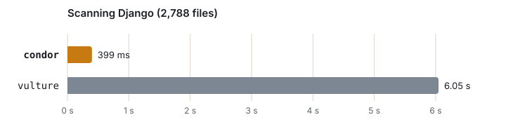

<picture>
  <source media="(prefers-color-scheme: dark)" srcset="docs/assets/hero-dark.svg">
  
</picture>

Finds unused Python code: functions nobody calls, classes nobody uses,
leftover imports and variables, unreachable code. A faster
[vulture](https://github.com/jendrikseipp/vulture) with fewer false positives.

```
uvx cndr src/
```

Install with `uv tool install cndr` (or `pip install cndr`); the commands are
`condor` and `cndr`.

**Documentation: https://mde-pach.github.io/condor/**

<picture>
  <source media="(prefers-color-scheme: dark)" srcset="docs/assets/bench-dark.svg">
  
</picture>

More in the [results](https://mde-pach.github.io/condor/results/).

## Repository

| Path | Contents |
|---|---|
| `crates/` | condor in Rust: engine, Python analysis, command line |
| `tests/upstream/` | vulture's own test suite, run against condor |
| `harness/` | comparison with vulture on real projects ([summary](harness/SUMMARY.md)), benchmark |
| `spec/` | detailed specification: [vulture behaviour](spec/compatibility.md), [improvements](spec/improvements.md), [differences](spec/divergences.md) |
| `docs/` | the documentation site |

## Licence

MIT. vulture's bundled whitelists and test suite are copyright Jendrik Seipp,
MIT.
